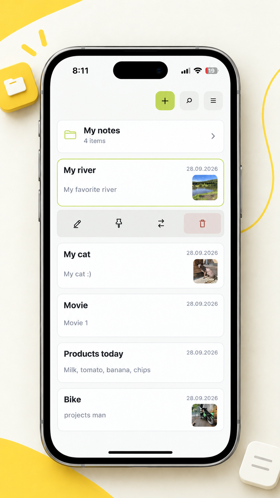
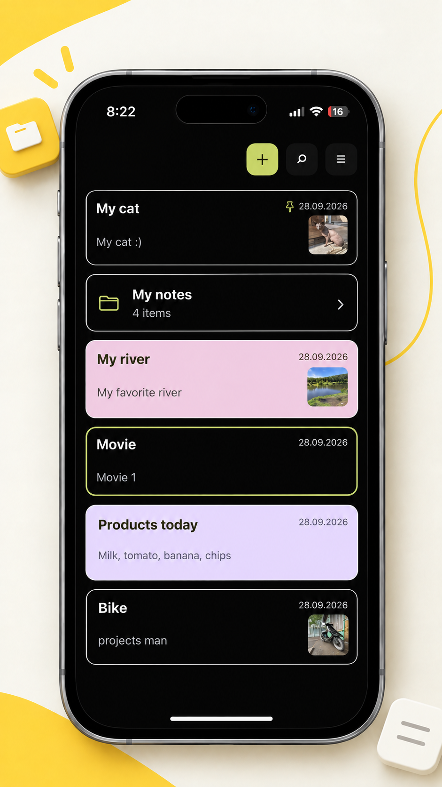
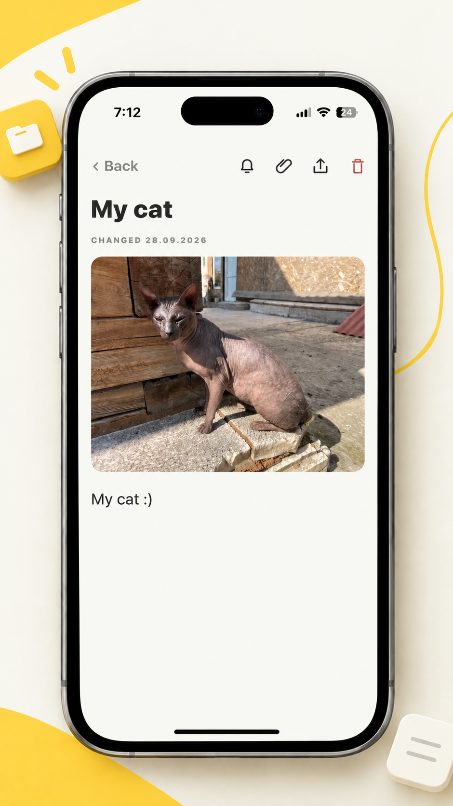
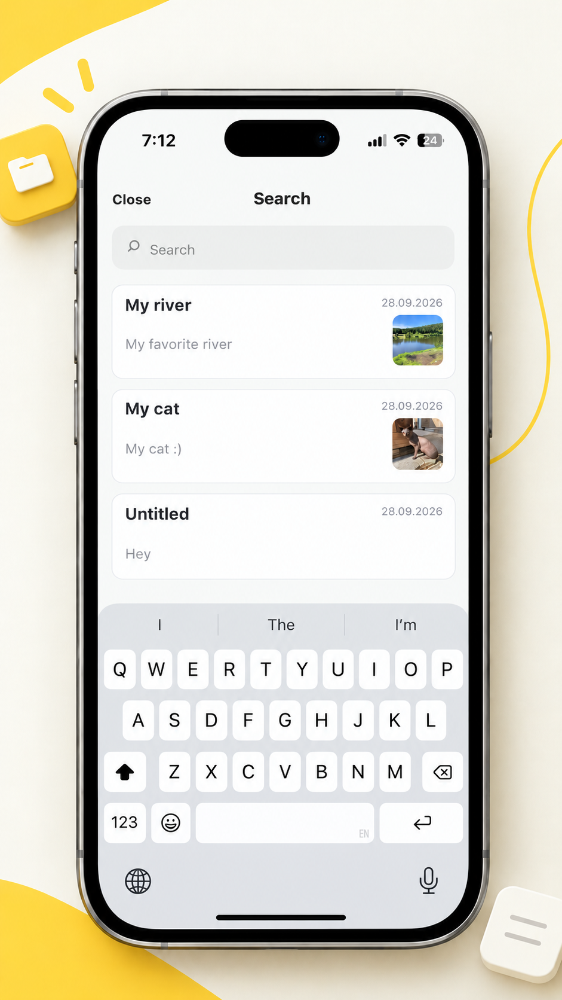
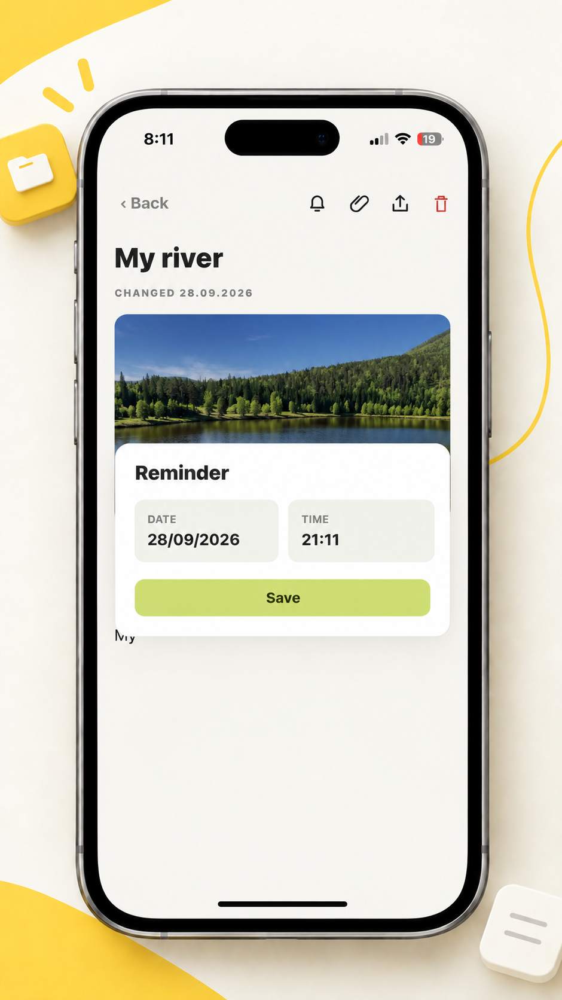
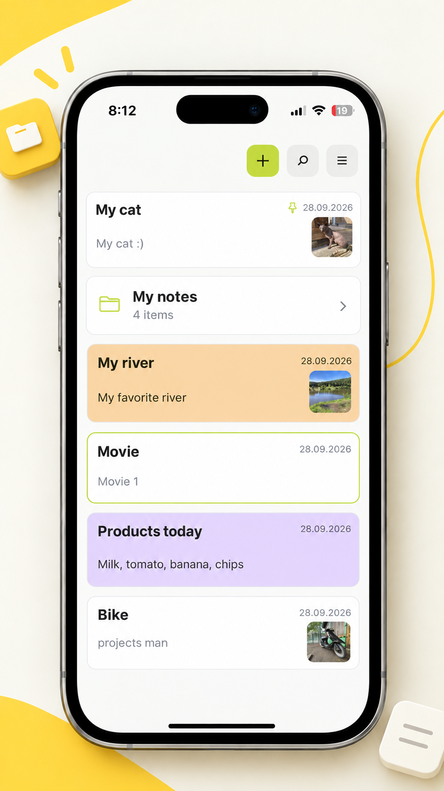

<div align="center">
  
  <h1>Блокнот</h1>
  <p>Личные записи и идеи — аккуратно, просто и всегда под рукой.</p>
  <p>
    
    
    
  </p>
  <p><a href="#русский">Русский</a> · <a href="#english">English</a></p>
</div>

## Русский

**Блокнот** — мобильное приложение для заметок, фотографий и напоминаний. Интерфейс доступен на русском, английском, испанском, немецком и китайском языках.

### Скриншоты приложения

<table>
  <tr>
    <td align="center"><br />Главный экран · светлая тема</td>
    <td align="center"><br />Главный экран · тёмная тема</td>
  </tr>
  <tr>
    <td align="center"><br />Запись с фотографией</td>
    <td align="center"><br />Поиск</td>
  </tr>
  <tr>
    <td align="center"><br />Напоминания</td>
    <td align="center"><br />Цветовые выделения</td>
  </tr>
</table>

### Возможности

- 🗂️ Создание папок и вложенных папок для организации записей
- 🔎 Поиск по заметкам
- 📌 Закрепление важных записей, цветовая подсветка и перемещение между папками
- 🖼️ Фотографии во вложениях, сохранение изображений и обмен заметками
- 🔔 Напоминания о записях
- 🎨 Светлая, тёмная и системная темы, настройка акцентного цвета
- 💾 Автоматическое сохранение и перенос данных через резервную копию

### Данные и конфиденциальность

Регистрация не требуется: заметки, настройки и фотографии сохраняются на устройстве. Приложение не синхронизирует данные с сервером. Резервную копию можно вручную экспортировать и импортировать на другом устройстве.

### Запуск

Понадобятся Node.js и npm.

```bash
npm install
npx expo start
```

Для запуска на конкретной платформе:

```bash
npm run android
npm run ios   # Требуются macOS и Xcode
npm run web
```

Конфигурация Android в [app.json](./app.json) ссылается на `google-services.json`, которого нет в репозитории. Если он нужен для сборки Android, настройте собственный Firebase-конфиг локально и **не добавляйте его в Git**.

Проект использует [Expo SDK 57](https://docs.expo.dev/versions/v57.0.0/).

### Структура проекта

```text
App.js                 Основной экран и логика приложения
src/notebookData.js    Модели данных, темы и вспомогательные функции
src/NotebookIcons.js   Векторные иконки интерфейса
plugins/               Плагины конфигурации Expo
assets/                Иконки и графические ресурсы
```

## English

**Notebook** is a mobile notes app for organizing thoughts, photos, and reminders. The interface is available in English, Russian, Spanish, German, and Chinese.

### Features

- 🗂️ Create folders and nested folders to organize your notes
- 🔎 Search your notes
- 📌 Pin important notes, highlight them with color, and move them between folders
- 🖼️ Attach photos, save images, and share notes
- 🔔 Set reminders for your notes
- 🎨 Choose a light, dark, or system theme and customize the accent color
- 💾 Notes are saved automatically; export and import backups to move your data

### Data and privacy

No account is required. Notes, settings, and attached photos are stored on your device. The app does not sync data to a server. You can manually export a backup and import it on another device.

### Getting started

You will need Node.js and npm.

```bash
npm install
npx expo start
```

Run on a specific platform:

```bash
npm run android
npm run ios   # Requires macOS and Xcode
npm run web
```

The Android configuration in [app.json](./app.json) references `google-services.json`, which is not included in this repository. If your Android build requires it, provide your own local Firebase configuration and **do not commit it to Git**.

This project uses [Expo SDK 57](https://docs.expo.dev/versions/v57.0.0/).

### Project structure

```text
App.js                 Main app screen and logic
src/notebookData.js    Note data models, themes, and helpers
src/NotebookIcons.js   Vector interface icons
plugins/               Expo configuration plugins
assets/                App icons and other visual assets
```
